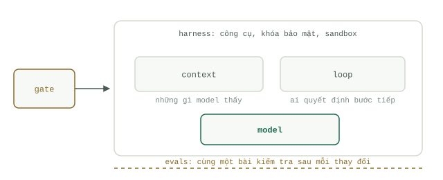

# Năm tầng kiến trúc, một hệ thống

Hãy hình dung một `Agent` giống như một nhân viên mới trong ngày đầu đi làm. Anh ta thông minh, nhanh nhẹn, nhưng chưa biết bất cứ điều gì về công ty của bạn. Mọi yếu tố quyết định việc anh ta có làm việc thành công hay không nằm ở hệ thống mà bạn xây dựng bao quanh anh ta — và hệ thống đó có chính xác năm tầng.

Giới chuyên môn thường bàn về các tầng này như thể chúng là những trường phái đối lập nhau: `Context engineering`, `Loop` engineering, `Jev` engineering, `Harness` engineering, `Evals` engineering. Năm từ khóa thời thượng, năm chủ đề hội thảo, năm nhóm người bảo bạn rằng bốn thứ còn lại chỉ là sự thổi phồng. Thực ra chúng không phải là các phương pháp cạnh tranh nhau. Chúng là năm tầng của cùng một hệ thống, và mỗi tầng trả lời đúng một câu hỏi: nó nhìn thấy gì, ai ra quyết định, ai phân loại, nó chạm được tới đâu, và làm sao bạn biết nó hoạt động tốt.

## Context: Nó nhìn thấy gì

Đó là những gì đặt trên bàn làm việc của nhân viên mới khi bắt đầu tác vụ. Bản mô tả yêu cầu, các tập tin liên quan, một trang lịch sử duy nhất thực sự quan trọng — và không có gì thừa thãi ngoài những thứ đó. Mô hình chỉ suy luận dựa trên những gì nằm trong `Context window`; mọi thứ nằm ngoài cửa sổ đó đều không tồn tại đối với nó. Nếu thiếu tầng này, `Agent` sẽ đoán mò, tự bịa ra những câu trả lời nghe có vẻ hợp lý cho những câu hỏi mà nó chưa từng được cung cấp thông tin, và hỏi đi hỏi lại những thứ vốn đã được đưa cho từ trước. Một `Context` tồi thường xuyên bị chẩn đoán nhầm thành một mô hình tồi.

## Loop: Ai ra quyết định

Nhân viên đó làm việc theo một danh sách kiểm tra (checklist) có sẵn, hay tự mình quyết định bước tiếp theo? Một danh sách kiểm tra chính là `Workflow`: rẻ, dễ đoán, nhưng sẽ đứng hình ngay khi gặp tình huống bất ngờ đầu tiên. Các bước tự định hướng chính là một `Agent` `Loop`: linh hoạt, đắt đỏ, và có nguy cơ đi lan man. Nếu không thiết kế `Loop` một cách có chủ đích, bạn sẽ rơi vào một trong hai thất bại — hoặc là một kịch bản cứng nhắc bị gãy ngay khi gặp tình huống phát sinh, hoặc là một kẻ lang thang đốt sạch token chỉ đểวน quanh ba tập tin giống hệt nhau.

## Gate: Ai phân loại công việc

Đó là quầy lễ tân phân loại thư từ gửi đến. Không phải mọi yêu cầu đều đáng để giao cho nhân sự đắt giá nhất xử lý: một quyết định nhỏ và nhanh — một bộ phân loại (classifier), một mô hình giá rẻ, hoặc một tập luật (rule) — sẽ điều hướng những việc vặt ra chỗ khác và chỉ đưa những công việc thực sự quan trọng vào trong. Nếu không có `Gate`, mọi thứ đều sẽ đâm thẳng vào luồng xử lý đắt đỏ nhất, bao gồm cả rác, các yêu cầu trùng lặp, và cả những luồng truy cập lẽ ra không bao giờ được phép chạm tới một `Agent` đang nắm giữ quyền hạn hệ thống.

## Harness: Nó chạm được tới đâu

Đó là văn phòng làm việc của anh ta: các công cụ trên bàn, chùm chìa khóa trao tay, và người kiểm tra lại kết quả trước khi xuất bản ra ngoài. Quyền hạn (permissions), môi trường cách ly (sandboxes), giới hạn thời gian chạy (timeouts), và cơ chế duyệt (review). Nếu thiếu `Harness`, `Agent` sẽ trở nên hoặc là vô dụng — chỉ biết ra quyết định trên giấy nhưng không thể hành động — hoặc là cực kỳ nguy hiểm: nó có thể tác động lên mọi thứ mà không có ai kiểm tra trước khi hành động đó gây ra hậu quả thực tế.

## Evals: Làm sao bạn biết nó hiệu quả

Cùng một bài kiểm tra, lặp lại đều đặn hàng tháng. Không phải một màn trình diễn demo, cũng không phải kiểu kiểm tra cảm tính (vibe check) sau mỗi lần sửa prompt — mà là một bộ các tác vụ cố định với đáp án đã biết trước, được chạy kiểm tra trên mọi phiên bản. Nếu không có `Evals`, bạn chỉ có thể cảm nhận một cách mơ hồ liệu thay đổi vừa rồi có giúp ích hay không, và người phát hiện ra lỗi suy giảm chất lượng (regression) chính là người dùng của bạn.

## Bản đồ tổng thể

Sự cố ở một tầng thường khoác lên mình lớp mặt nạ của một tầng khác: thiếu `Context` trông giống như mô hình bị ngốc, thiếu `Gate` trông giống như chi phí tăng vọt mất kiểm soát, còn thiếu `Evals` thì trông như chẳng có vấn đề gì cả cho đến khi hệ thống sập trên môi trường `Production`. Mỗi tầng sẽ được giải quyết trong một học phần của khóa học này, và bốn tầng trong số đó có riêng một cuốn cẩm nang chuyên sâu (handbook). Cách chia tách này là nguyên tắc xuyên suốt của toàn bộ trang tài liệu: học phần sẽ dạy tư duy cốt lõi một lần theo đúng trình tự; còn cẩm nang lưu giữ toàn bộ danh mục kỹ thuật, công cụ và hướng dẫn triển khai chi tiết để bạn tra cứu bất cứ khi nào tầng đó bắt đầu gây đau đầu.

| Tầng | Câu hỏi cốt lõi | Học phần | Cẩm nang chuyên sâu |
| --- | --- | --- | --- |
| `Context` | Nó nhìn thấy gì? | [Học phần 1: Cách mô hình đọc Context](../course-1-context/how-models-read.md) | Học phần 1 chính là cẩm nang chuyên sâu |
| `Loop` | Ai quyết định bước tiếp theo? | [Học phần 2: Loop so với Workflow](../course-2-loop/loops-vs-workflows.md) | [Kỹ thuật thiết kế Loop là gì](../track-loop/what-loop-engineering-is.md) |
| `Gate` | Ai phân loại công việc đầu vào? | [Học phần 3: Những quyết định chi phí thấp](../course-3-gate/cheap-decisions.md) | [Các mô hình System One](../track-jev/system-one-models.md) |
| `Harness` | Nó có thể chạm tới đâu? | [Học phần 4: Văn phòng làm việc](../course-4-harness/the-office.md) | [Harness là gì](../track-harness/what-a-harness-is.md) |
| `Evals` | Làm sao biết hệ thống hoạt động tốt? | [Học phần 5: Hai loại kiểm tra](../course-5-evals/two-kinds-of-checks.md) | [Tại sao cần Evals](../track-evals/why-evals.md) |

## Tự kiểm tra

- `Agent` của bạn liên tục yêu cầu đọc lại một tập tin vốn đã nằm sẵn trong `Context` của nó từ hai bước trước. Tầng nào đang gặp sự cố, và tại sao triệu chứng này lại trông giống như lỗi của mô hình?
- Một đồng nghiệp khăng khăng rằng kỹ thuật đánh giá (`Evals` engineering) đã thay thế hoàn toàn kỹ thuật viết prompt (prompt engineering). Dựa vào năm câu hỏi cốt lõi trên, hãy giải thích tại sao nhận định đó là một sự nhầm lẫn về mặt phạm trù.
