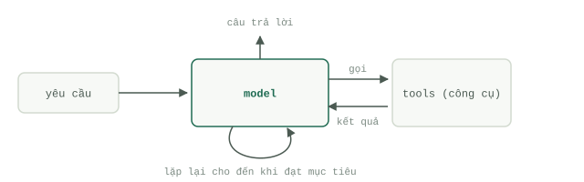

# Agent là gì

Sách trắng [Introduction to Agents](https://www.kaggle.com/whitepaper-introduction-to-agents) của Google (Kaggle, tháng 11/2025) định nghĩa `Agent` là một ứng dụng biết lập kế hoạch và thực hiện các hành động nhằm đạt được mục tiêu — chứ không đơn thuần là một mô hình trả lời câu hỏi. Định nghĩa này nghe có vẻ bình thường, nhưng hệ quả của nó thì không hề nhỏ: mô hình chỉ là một trong bốn thành phần cấu thành, và thường không phải là thành phần gây ra lỗi.

## Mô hình, công cụ và tầng điều phối

Sách trắng chỉ ra bốn thành phần cốt lõi. Mô hình (model) là bộ não: cỗ máy suy luận quyết định bước tiếp theo cần làm gì. Công cụ (`Tool use` / tools) là đôi bàn tay: các API, môi trường thực thi code, truy vấn cơ sở dữ liệu — bất cứ thứ gì giúp suy luận chạm tới thế giới thực. Tầng điều phối (orchestration layer) là hệ thần kinh: vòng lặp (`Loop`) chịu trách nhiệm lắp ghép `Context`, gọi mô hình, thực thi yêu cầu mà mô hình đưa ra, rồi đưa kết quả quay ngược trở lại. Triển khai (deployment) là phần cơ thể: hạ tầng lưu trữ (hosting), ghi nhật ký (logging), giám sát (monitoring) và những công việc hậu trường không mấy hào nhoáng khác.

`Loop` chính là phần mà mọi người thường đánh giá thấp. Tài liệu này mô tả chu trình suy nghĩ – hành động – quan sát (think–act–observe): `Agent` nhận nhiệm vụ, rà soát những gì mình có, lên kế hoạch cho một bước, thực hiện bước đó, quan sát kết quả xảy ra và lặp lại chu trình cho đến khi đạt được mục tiêu. Nếu gạt bỏ hết những mỹ từ quảng cáo, một `Agent` thực chất là một `Loop` liên tục tái cấu trúc `Context` của mô hình giữa các bước thực thi.

## Năm cấp độ tự chủ của Agent

Thay vì phân loại nhị phân (có hoặc không), sách trắng phân chia hệ thống theo các cấp độ:

- Cấp độ 0 — Mô hình thuần túy, chỉ suy luận dựa trên dữ liệu huấn luyện. Không có công cụ, không có bộ nhớ.
- Cấp độ 1 — Bộ giải quyết vấn đề có kết nối: mô hình kết hợp với công cụ (`Tool use`), nhờ đó có thể truy xuất những thông tin mà bản thân nó chưa biết.
- Cấp độ 2 — Bộ giải quyết vấn đề chiến lược: lập kế hoạch đa bước và thực hiện `Context engineering` có chủ đích.
- Cấp độ 3 — Hệ thống đa `Agent` cộng tác: các `Agent` chuyên biệt coi nhau như những công cụ để phối hợp.
- Cấp độ 4 — Hệ thống tự tiến hóa: tự tạo ra công cụ hoặc `Agent` mới khi phát hiện khoảng trống về năng lực.

Hầu hết những hệ thống đang chạy trong môi trường `Production` hiện nay nằm ở cấp độ 1 và 2. Đây không phải là lời chê bai; đó chính là nơi mang lại hiệu quả đầu tư thực tế nhất.

## Không phải chatbot, cũng không phải Workflow

Một chatbot chỉ trả lời từng tin nhắn một và con người là người quyết định mọi bước đi tiếp theo. Một `Workflow` — theo định nghĩa của Anthropic — là hệ thống mà các lệnh gọi mô hình và công cụ chạy theo những luồng code đã được lập trình sẵn từ trước. Ngược lại, `Agent` là hệ thống mà mô hình tự điều hướng quy trình của chính nó: tự quyết định bước tiếp theo dựa trên những gì vừa quan sát được. Câu hỏi phân định ranh giới luôn chỉ có một: ai là người quyết định điều gì xảy ra tiếp theo — con người, code của bạn, hay mô hình?

## Khi nào Agent phát huy giá trị

Các ví dụ trong chính sách trắng đã bao quát toàn bộ dải ứng dụng này. Ở quy mô nhỏ, một `Agent` hỗ trợ khách hàng giải quyết câu hỏi "đơn hàng của tôi đang ở đâu?" bằng cách tự gọi các API tra cứu đơn hàng và theo dõi vận đơn, thay vì đi theo một cây quyết định kịch bản cứng nhắc. Ở quy mô lớn, hệ thống Co-Scientist của Google, nơi một `Agent` giám sát phân công nhiệm vụ cho các `Agent` chuyên biệt — khởi tạo, phản tư, xếp hạng, tiến hóa, đánh giá tổng quan (meta-review) — để tinh chỉnh các giả thuyết khoa học suốt nhiều giờ hoặc nhiều ngày; và AlphaEvolve, hệ thống đề xuất và kiểm thử các thuật toán tiềm năng, tạo ra những cải tiến thực tế về hiệu suất trung tâm dữ liệu cũng như phép nhân ma trận.

Điểm chung của chúng: các bước thực hiện không thể được viết sẵn từ trước, nhưng kết quả đầu ra có thể kiểm chứng được. Ở những nơi mà các bước có thể viết thành quy trình rõ ràng, hãy viết chúng ra — lập luận đó được phân tích kỹ tại bài [Chọn Agent hay Workflow](agents-or-workflows.md). Và bốn thành phần trên mới chỉ là giải phẫu của một nhân sự đơn lẻ; hệ thống bao quanh nó chính là [năm tầng kiến trúc](five-layers.md).

## Tự kiểm tra

- Hãy kể tên bốn thành phần mà sách trắng dùng để cấu thành một `Agent`. Thành phần nào chứa vòng lặp suy nghĩ – hành động – quan sát (`Loop`)?
- Hệ thống của bạn gọi mô hình ba lần theo một thứ tự cố định và không có nhánh rẽ nào. Nó đang ở cấp độ mấy, và nó có phải là một `Agent` không?
