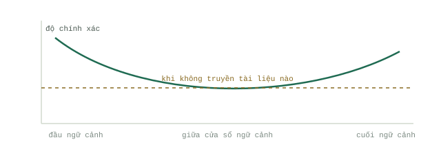

# Cách mô hình đọc Context

Một `Context window` lớn hơn thoạt nhìn giống như dung lượng miễn phí. Thực tế hoàn toàn không phải vậy. Mô hình đọc từng token bạn gửi vào, nhưng nó không phân bổ trọng số chú ý đồng đều cho tất cả, và vượt qua một ngưỡng nhất định, mỗi token dư thừa không chỉ làm câu trả lời chậm hơn, đắt hơn mà còn khiến chất lượng tệ đi. Trang này giải thích cơ chế vận hành bên dưới; còn bài [Bốn vị trí đặt Context](the-four-places.md) sẽ trình bày các nguyên tắc kỷ luật được xây dựng dựa trên cơ chế đó.

## Cơ chế chú ý (Attention) có hình dạng riêng

Trong nghiên cứu [Lost in the Middle](https://arxiv.org/abs/2307.03172) (Liu và cộng sự, 2023), các mô hình được yêu cầu trả lời câu hỏi dựa trên một tập hợp các tài liệu truy xuất được, trong đó tài liệu duy nhất chứa đáp án đúng được dịch chuyển lần lượt qua các vị trí khác nhau trong tập hợp. Với 20 tài liệu, GPT-3.5-Turbo đạt độ chính xác 75,8% khi đáp án nằm ở tài liệu đầu tiên, tụt xuống 53,8% khi đáp án nằm ở khoảng giữa, và đạt 63,2% khi nằm ở cuối cùng. Trong khi đó, mức cơ sở khi không dùng tài liệu nào (closed-book baseline) — trả lời cùng câu hỏi đó mà không cung cấp văn bản kèm theo — là 56,1%. Nghĩa là khi đáp án hiện diện rõ ràng trong `Context window` nhưng bị chôn vùi ở đoạn giữa, mô hình còn làm tệ hơn cả khi không được cung cấp tài liệu nào.

Đường cong hình chữ U tương tự cũng xuất hiện nhất quán trên GPT-3.5-Turbo (bản 4K và 16K), Claude 1.3 (bao gồm cả biến thể 100K), MPT-30B-Instruct và LongChat-13B, trên cả các tập hợp gồm 10, 20 và 30 tài liệu. Các mô hình tập trung sự chú ý mạnh mẽ vào phần đầu của cửa sổ (hiệu ứng ưu tiên đầu - primacy) và phần cuối của cửa sổ (hiệu ứng gần nhất - recency), nhưng lại rất yếu ở toàn bộ phần nằm giữa. Các thế hệ mô hình mới hơn đã làm phẳng đường cong này phần nào, nhưng chưa một mô hình nào xóa bỏ được hoàn toàn. Sách trắng của Google có tựa đề [Context Engineering: Sessions & Memory](https://www.kaggle.com/whitepaper-context-engineering-sessions-and-memory) (Milam và Gulli, tháng 11/2025) gọi hiện tượng suy giảm diện rộng này là "sự thối rữa ngữ cảnh" (context rot): khi `Context` phình to ra, khả năng mô hình tập trung chú ý vào các thông tin then chốt sẽ suy giảm dần.

## Mỗi token đều tiêu tốn chi phí theo bốn chiều

Cũng chính sách trắng đó đã chỉ ra bốn giới hạn thực tế đối với `Context` dài: giới hạn cứng của `Context window`, chi phí API, độ trễ (latency) và chất lượng đầu ra. Giới hạn cứng của cửa sổ là thứ mọi người hay sợ nhất nhưng lại là thứ chạm ngưỡng muộn nhất. Ngược lại, chi phí, độ trễ và chất lượng đã bắt đầu suy giảm liên tục ngay từ token thừa thãi đầu tiên được thêm vào.

Chi phí này còn nhân lên theo cấp số cộng trong các `Loop` của `Agent`. Mỗi lượt (turn) gọi mô hình đều phải gửi lại toàn bộ lịch sử hội thoại trước đó, vì vậy một `Loop` gồm N lượt sẽ phải trả tiền cho phần `Context` của nó xấp xỉ N lần. Một tiến trình chạy 30 lượt mang theo 20.000 token dữ liệu thừa sẽ không chỉ lãng phí 20.000 token; nó lãng phí tới khoảng 600.000 token. Độ trễ cũng tăng lên theo quy luật tương tự, và chất lượng câu trả lời sụt giảm khi những tín hiệu quan trọng bạn cần bị đẩy dần về vùng trũng ở giữa cửa sổ.

## Prompt caching trả thưởng cho sự tĩnh lặng

Các nhà cung cấp mô hình sẵn sàng phục vụ lại phần tiền tố (prefix) không thay đổi với mức chiết khấu rất sâu. Cơ chế [Prompt caching](https://platform.claude.com/docs/en/docs/build-with-claude/prompt-caching) của Anthropic tính phí đọc từ bộ nhớ đệm (cache read) chỉ bằng 0,1 lần giá token đầu vào cơ bản cho hầu hết các mô hình — tức là rẻ hơn mười lần — trong khi chi phí ghi vào cache là 1,25 lần cho thời gian lưu mặc định 5 phút (hoặc 2 lần cho bộ nhớ đệm lưu 1 giờ).

Tuy nhiên, điều kiện đi kèm cực kỳ khắt khe: để đạt được một lần trúng bộ nhớ đệm (cache hit), phần tiền tố phải giống hệt nhau 100% từng byte một cho đến tận điểm ngắt cache (cache breakpoint). Bộ nhớ đệm được tổ chức theo cấu trúc phân cấp — công cụ (`Tool use` definitions) trước tiên, sau đó đến system prompt, rồi mới đến danh sách tin nhắn (messages) — vì vậy chỉ cần chỉnh sửa định nghĩa của một công cụ thôi cũng sẽ làm mất hiệu lực toàn bộ phần cache phía sau nó, và bất kỳ thay đổi nào trong system prompt cũng sẽ xóa sạch hiệu lực cache của toàn bộ lịch sử tin nhắn. Việc chèn một dấu thời gian (timestamp) động vào system prompt chắc chắn sẽ gây trượt cache (cache miss) ở mọi lệnh gọi, âm thầm khiến bạn phải trả đắt gấp 10 lần. Ngoài ra còn có ngưỡng độ dài tối thiểu để được lưu cache, dao động từ 512 đến 4.096 token tùy thuộc vào mô hình; nếu ngắn hơn ngưỡng này, việc lưu cache sẽ bị bỏ qua mà không hề báo lỗi.

## Hình hài của giải pháp

Cơ chế vật lý bên dưới đã chỉ rõ một hướng giải quyết duy nhất. Những nội dung không bao giờ thay đổi phải được đặt ở ngay đầu tiên, nơi chúng vừa rẻ (nhờ `Prompt caching`) vừa nhận được sự chú ý cao (nhờ hiệu ứng primacy). Những nội dung quan trọng ngay tại thời điểm hiện tại phải được đặt ở tận cùng phía cuối, nơi hiệu ứng recency phát huy tác dụng cho bạn. Mọi dữ liệu dung lượng lớn hoặc chỉ mang tính tạm thời cần được đưa ra khỏi `Context window` hoàn toàn, lưu xuống ổ đĩa và chỉ truy xuất khi thực sự cần đến. Nguyên tắc sắp xếp vị trí đó chính là nội dung của trang tiếp theo, và cuốn cẩm nang chuyên sâu về `Harness` sẽ có một [bài phân tích sâu hơn](../track-harness/context-engineering.md) về cách tích hợp nguyên tắc này vào một `Agent` thực thụ.
