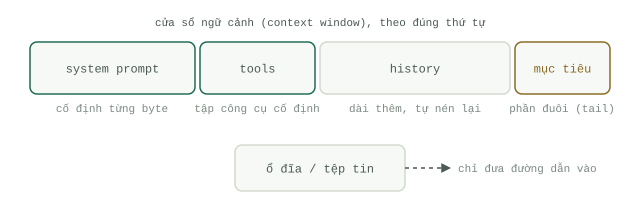

# Bốn vị trí đặt Context

Bài [Cách mô hình đọc Context](how-models-read.md) đã thiết lập các quy luật vật lý cơ bản: sự chú ý của mô hình ưu tiên phần đầu và phần cuối của `Context window`, mỗi token đều tiêu tốn chi phí, và `Prompt caching` chỉ phát huy tác dụng khi phần tiền tố (prefix) hoàn toàn bất biến. Nguyên tắc kỷ luật rút ra từ đó rất dễ phát biểu: mỗi mảnh `Context` chỉ thuộc về đúng một trong bốn vị trí, và hầu hết các vấn đề của `Agent` đều bắt nguồn từ việc đặt nhầm thứ gì đó vào sai vị trí.




## Một: System prompt

Chỉ chứa những gì luôn đúng trong mọi lệnh gọi. Nhân cách (persona), các quy tắc cứng, định dạng đầu ra — và không gì khác. Nó phải ổn định tuyệt đối tới từng byte: không dấu thời gian (timestamp), không tên người dùng, không bộ nhớ truy xuất động, không "nhiệm vụ hiện tại". Bất kỳ thông tin động nào nằm trong system prompt đều sẽ phá vỡ bộ nhớ đệm ở mọi yêu cầu gửi đi (vì system prompt nằm trên lịch sử tin nhắn trong hệ thống phân cấp cache) và lãng phí vùng ưu tiên chú ý đầu cửa sổ (primacy slot) cho những nội dung không cần đến nó. Hãy coi mỗi lần chỉnh sửa system prompt như một lần phát hành phiên bản mới (release), chứ không phải những tinh chỉnh tùy hứng.

## Hai: Công cụ (Tools)

Tập hợp các công cụ (`Tool use`) phải được cố định trong suốt cuộc hội thoại. Tuyệt đối không thêm hoặc xóa định nghĩa công cụ giữa chừng khi hệ thống đang chạy: các công cụ nằm ở vị trí đầu tiên trong phân cấp cache, nên chỉ cần chạm vào một công cụ là toàn bộ phần tiền tố đã lưu cache phía sau bị vô hiệu hóa, đồng thời hành vi của mô hình cũng bị xáo trộn theo. Khi một công cụ cần phải tạm ngưng sử dụng, hãy chặn lệnh gọi nó ở tầng thực thi — bắt lấy lệnh gọi và trả về thông báo "công cụ này đã bị vô hiệu hóa cho tác vụ hiện tại" — giữ nguyên vẹn các bản định nghĩa công cụ.

Bản thân các định nghĩa công cụ rất tốn token. Bài viết [Advanced tool use](https://www.anthropic.com/engineering/advanced-tool-use) của Anthropic (tháng 11/2025) đã đo lường một thiết lập `MCP` gồm năm máy chủ thông thường với 58 công cụ: hệ thống này ngốn khoảng 55.000 token ngay trước khi cuộc hội thoại kịp bắt đầu, và từng ghi nhận tới 134.000 token định nghĩa công cụ trong nội bộ trước khi được tối ưu hóa. Nếu có dưới khoảng hai mươi công cụ, hãy nạp tất cả cùng lúc; vượt quá con số đó, hãy chuyển sang cơ chế tìm kiếm công cụ (tool search), được hướng dẫn chi tiết trong bài [Thực hành quản trị Context](context-practice.md).

## Ba: Ổ đĩa (Disk)

Bất cứ dữ liệu nào có dung lượng lớn hoặc tồn tại lâu dài đều phải được lưu thành tập tin trên ổ đĩa; chỉ có đường dẫn (path) của tập tin mới được đưa vào `Context window`. Hãy giữ chiếc chìa khóa, đừng giữ toàn bộ nội dung. Một công cụ tải về một trang web dài 40.000 token không nên trả về nguyên trang web đó:

```python
import hashlib, pathlib, urllib.request

def fetch_to_disk(url: str) -> str:
    text = urllib.request.urlopen(url).read().decode("utf-8", "replace")
    path = pathlib.Path("cache") / (hashlib.sha1(url.encode()).hexdigest() + ".txt")
    path.parent.mkdir(exist_ok=True)
    path.write_text(text, encoding="utf-8")
    return f"saved {len(text)} chars to {path}"
```

`Agent` sẽ chỉ đọc từng lát cắt nhỏ của tập tin khi nó thực sự cần. Lúc này, `Context window` chỉ chứa một biên nhận dài vỏn vẹn 15 token thay vì toàn bộ tài liệu khổng lồ.

## Bốn: Phần đuôi (Tail)

Phần cuối cùng của `Context window` là mảnh đất vàng nhận được nhiều sự chú ý nhất mà bạn có. Hãy nhắc lại mục tiêu hiện tại ở đó sau mỗi vài bước thực thi: chỉ cần một hoặc hai dòng, nối thêm vào ngay sau kết quả trả về mới nhất của công cụ. Trong một `Loop` kéo dài, chỉ thị ban đầu đã bị trôi dạt vào vùng trũng chú ý ở giữa cửa sổ; việc nhắc lại mục tiêu ở phần đuôi chính là thứ giữ cho mô hình đi đúng hướng chỉ với chi phí khoảng ba mươi token mỗi lượt.

## Những gì được giữ lại sau phiên làm việc

Sách trắng [Sessions & Memory whitepaper](https://www.kaggle.com/whitepaper-context-engineering-sessions-and-memory) của Google đã vạch ra ranh giới rất rõ ràng: phiên làm việc (session) là bàn làm việc cho một cuộc hội thoại đơn lẻ; còn bộ nhớ (memory) là tủ hồ sơ lưu trữ xuyên suốt qua nhiều cuộc hội thoại. Định nghĩa của họ rất đáng lưu tâm — bộ nhớ là thông tin đã được trích xuất và chắt lọc, chứ không phải đoạn hội thoại thô nguyên bản. Bạn không lưu trữ toàn bộ bản ghi hội thoại (transcript) làm bộ nhớ; thay vào đó, bạn chạy quy trình trích xuất (một mô hình LLM chỉ rút ra các sự kiện khớp với những chủ đề đã định nghĩa như sở thích, quyết định, mục tiêu) và sau đó là quy trình hợp nhất (consolidation), nơi các thông tin mới được đem so sánh với thông tin cũ để gộp lại, cập nhật hoặc xóa bỏ nếu mâu thuẫn. Cả hai quy trình này đều chạy ngầm (background) sau khi câu trả lời đã được gửi đi, tuyệt đối không nằm trên luồng xử lý chính (hot path). Thứ bạn lưu giữ giữa các phiên làm việc là bản hồ sơ đã chắt lọc: các sở thích ổn định, các quyết định có hiệu lực lâu dài, và những dữ kiện quan trọng đã được xác thực. Còn bản ghi transcript thô vẫn nằm trên ổ đĩa để làm bằng chứng truy xuất nguồn gốc (provenance).

## Nén gọn Context window (Compaction)

Đối với phiên làm việc đang diễn ra trực tiếp, sách trắng nêu ra ba chiến lược theo mức độ tinh vi tăng dần: giữ lại N lượt hội thoại gần nhất (cửa sổ trượt - sliding window), cắt bớt dựa trên số lượng token (lấp đầy ngân sách token theo thứ tự ưu tiên từ mới nhất trở về trước), và tóm tắt đệ quy (thay thế các lượt hội thoại cũ bằng một bản tóm tắt cuốn chiếu đặt ngay trước các lượt hội thoại nguyên văn gần nhất). Hãy kích hoạt quá trình nén (compaction) khi chạm ngưỡng số lượt, khi phiên làm việc tạm nghỉ, hoặc khi hoàn thành một tác vụ. Trang [vệ sinh ngữ cảnh (context hygiene)](../track-loop/context-hygiene.md) trong cẩm nang chuyên sâu về `Loop` sẽ phân tích sâu hơn về kỹ thuật nén bên trong các vòng lặp chạy dài hạn.
