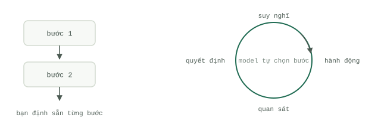

# Loop so với Workflow

Một `Workflow` là một chuỗi các bước bạn đã viết sẵn từ trước: bước một, bước hai, bước ba, hoàn tất. Một `Loop` chỉ khác biệt ở đúng một điểm duy nhất — bước tiếp theo được lựa chọn ngay trong thời gian chạy (run time), bởi chính mô hình, dựa trên những gì vừa mới diễn ra. Chu trình cứ thế lặp lại theo nhịp suy nghĩ, hành động, quan sát, quyết định: mô hình đề xuất một hành động, hành động được thực thi, kết quả được ghi nối vào lịch sử, và một cơ chế nào đó sẽ quyết định xem có nên đi tiếp một vòng nữa hay không. Sách trắng "Introduction to Agents" của Google (Kaggle, 2025) phác họa chu trình tương tự gồm: nhận nhiệm vụ, quét bối cảnh, suy nghĩ thấu đáo, thực hiện hành động, rồi quan sát và lặp lại, vận hành dựa trên bộ ba mô hình, công cụ (`Tool use`) và tầng điều phối. Từ vựng có thể khác nhau, nhưng hình thái cốt lõi thì không đổi.

## Ai chọn bước tiếp theo

Đó là toàn bộ sự khác biệt. Trong một `Workflow`, bạn đã chọn sẵn mọi bước ngay từ lúc thiết kế; code chỉ đơn thuần phát lại các quyết định của bạn, và cùng một dữ liệu đầu vào sẽ luôn đi theo cùng một nhánh trong mọi lần chạy. Trong một `Loop`, mô hình tự đưa ra lựa chọn tại thời điểm chạy, vì vậy hai lần chạy với cùng một đầu vào có thể đi theo hai con đường khác nhau — đó chính là điểm mạnh, và cũng là nguồn cơn của mọi rắc rối. Sách trắng của Google ví sự chuyển dịch này giống như việc lập trình viên chuyển từ người thợ xây gạch sang người đạo diễn: bạn ngừng việc tự tay đặt từng viên gạch ở mỗi bước, mà thay vào đó đặt ra mục tiêu, chọn bộ công cụ, và để hệ thống tự tìm đường đi. Làm đạo diễn tốn kém hơn làm thợ xây, và cũng khó kiểm toán hơn nhiều.

## Khi nào mỗi kiến trúc chiến thắng

`Workflow` chiến thắng bất cứ khi nào bạn có thể liệt kê trước các bước thực hiện. Cấu trúc đầu vào đã biết, các kiểu lỗi (failure modes) đã rõ, một luồng xử lý mà bạn có thể vẽ rành mạch lên bảng trắng — hãy viết nó bằng code thông thường. Nó chạy chỉ mất vài mili-giây, không tốn thêm đồng nào cho các nhánh rẽ, không bao giờ bịa đặt (hallucinate) ra một bước ma, và báo lỗi rõ ràng ngay trong trình gỡ lỗi (debugger). Phần lớn những thứ đang được xây dựng dưới danh nghĩa "`Agent`" ngày nay thực ra chỉ nên là một `Workflow` có gắn một hoặc hai lệnh gọi mô hình bên trong.

`Loop` chỉ thực sự chiến thắng khi con đường giải quyết bài toán hoàn toàn không thể viết trước: gỡ một lỗi lạ chưa từng gặp, điều tra một cảnh báo hệ thống mà nguyên nhân có thể nằm ở một trong hàng trăm chỗ, hoặc chỉnh sửa code cho đến khi vượt qua được bài kiểm thử bên ngoài. Yếu tố chưa biết nằm ở việc phân nhánh đường đi, chứ không phải bản thân công việc. Nếu bạn thấy mình đang viết mô tả kiểu "`Agent` trước tiên sẽ kiểm tra X, sau đó kiểm tra Y, rồi làm Z", thì thực chất bạn vừa viết ra một `Workflow` rồi — hãy triển khai thẳng `Workflow` đó.

## Bài toán chi phí

Sự tự chủ được định giá bằng token. Bài viết kỹ thuật của Anthropic về hệ thống nghiên cứu đa `Agent` của họ (tháng 6/2025) đã đo lường trực tiếp các tỷ lệ này: các vòng lặp `Agent` (`Loop`) tiêu tốn lượng token gấp khoảng bốn lần so với một tương tác chat đơn lẻ, và các hệ thống đa `Agent` tiêu tốn gấp khoảng mười lăm lần. Như vậy, một `Loop` phải mang lại giá trị cao gấp khoảng 4 lần một lệnh gọi mô hình đơn thuần, và một đội ngũ nhiều `Agent` phải mang lại giá trị gấp khoảng 15 lần thì mới xứng đáng với chi phí nuôi chúng. Hóa đơn chi phí còn nhân lên gấp bội bởi tính khó lường: sách trắng "Prototype to Production" của Google chỉ ra rằng vì lộ trình đi của `Agent` được lắp ghép động trong lúc chạy, nên chi phí và độ trễ của mỗi lần chạy là không thể đoán trước — và khoảng 80% công sức triển khai `Production` phải đổ vào hạ tầng, bảo mật và xác thực thay vì trí thông minh của bản thân `Agent`. Bạn không chỉ trả nhiều tiền hơn cho mỗi lần chạy; bạn còn đang phải trả tiền cho cả cỗ máy giữ cho các lần chạy đó nằm trong tầm kiểm soát.

## Quy tắc ra quyết định

Hãy tự hỏi một câu duy nhất: tôi có thể viết trước các bước thực hiện không?

- Có, hoàn toàn viết được — hãy dùng `Workflow`. Không đưa mô hình vào luồng điều khiển (control flow).
- Có, ngoại trừ một bước cần phán đoán — hãy dùng `Workflow` kèm theo một lệnh gọi mô hình duy nhất tại đúng điểm đó.
- Không, đường đi phụ thuộc vào những gì hé lộ sau mỗi bước — hãy dùng `Loop`, được giới hạn chặt chẽ bởi bốn thành phần trong bài [Bốn thành phần của một Loop](the-four-parts.md): một mục tiêu có thể kiểm thử, một bộ kiểm tra (`Checker`) bên ngoài, một quy tắc dừng (`Stop condition`) và một ngân sách giới hạn.

Hãy mặc định chọn cấu trúc rẻ nhất có thể giải quyết được bài toán thực tế, và chỉ nâng cấp lên cấu trúc phức tạp hơn khi có bằng chứng đòi hỏi rõ ràng. Kỷ luật thiết kế vòng lặp có giới hạn đó — thay vì chỉ viết prompt thủ công — được gọi là [kỹ thuật thiết kế Loop (loop engineering)](../track-loop/what-loop-engineering-is.md), và mô hình `Production` kết hợp cả hai cấu trúc lại với nhau (lọc trước, lặp ngắn, dự phòng) sẽ được xây dựng hoàn chỉnh từ đầu đến cuối trong bài [Thực hành Loop](loop-practice.md).
