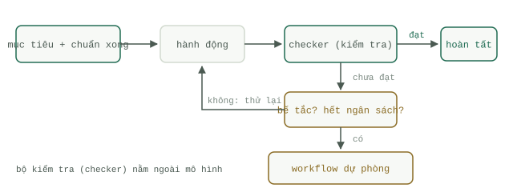

# Bốn thành phần của một Loop

Mọi `Loop` sống sót được trên môi trường `Production` đều có chung bốn thành phần: một mục tiêu có định nghĩa hoàn thành (done) có thể kiểm thử được, một bộ kiểm tra (`Checker`) nằm bên ngoài mô hình, một quy tắc dừng (`Stop condition`), và một ngân sách được đếm bằng cả số lượt chạy (turns) lẫn số tiền (dollars). Chỉ cần bỏ đi bất kỳ thành phần nào trong bốn thứ này, bạn không hề làm cho `Loop` đơn giản hơn; bạn vừa tháo bỏ phanh của nó. Trang này sẽ đi sâu vào từng thành phần, sau đó giải thích chi tiết trên bộ khung code chuẩn.




## Mục tiêu có định nghĩa hoàn thành kiểm thử được

Một mục tiêu kiểu "Cải thiện cơ chế xử lý lỗi" không thể nào làm điều kiện kết thúc cho một `Loop`, bởi không có bất cứ thứ gì có thể khẳng định khi nào nó đã hoàn tất. Ngược lại, "Tất cả các bài kiểm thử trong thư mục `tests/` đều vượt qua và công cụ linter không báo lỗi nào" thì hoàn toàn có thể. Mục tiêu phải được diễn đạt sao cho một chương trình máy tính — chứ không phải con người, và càng không phải bản thân mô hình — có thể trả về kết quả đúng (`true`) hoặc sai (`false`) khi đối chiếu với nó. Nếu bạn chưa thể viết định nghĩa hoàn thành dưới dạng một hàm kiểm tra tự động, nghĩa là bạn chưa có một tác vụ có thể chạy `Loop`; bạn mới chỉ có một phiên làm việc tương tác trực tiếp mà thôi. Việc viết định nghĩa hoàn thành thành một kịch bản code dài bốn mươi dòng tự thân nó đã là một kỹ năng quan trọng, được hướng dẫn cụ thể tại [trang xây dựng bài kiểm tra mục tiêu (goal test)](../track-loop/build-goal-test.md).

## Bộ kiểm tra (Checker) nằm ngoài mô hình

`Checker` là một bộ kiểm thử (test suite), một trình biên dịch (compiler), một công cụ kiểm tra mã nguồn (linter), hoặc một bộ xác thực lược đồ (schema validator) — bất kỳ công cụ cơ học nào phán xét kết quả mà không cần hỏi ý kiến của mô hình. Cơ chế tự đánh giá (self-review) của mô hình không phải là một `Checker`. Bằng chứng khoa học về điểm này rất trực diện: nghiên cứu của Huang và cộng sự, "Large Language Models Cannot Self-Correct Reasoning Yet" (ICLR 2024), đã chỉ ra rằng các mô hình gặp rất nhiều khó khăn khi tự sửa lỗi suy luận của chính mình nếu không có phản hồi từ bên ngoài, và hiệu suất đôi khi còn tệ đi sau khi tự sửa. Việc để mô hình tự chấm điểm bài làm của chính nó chẳng khác nào dùng cùng một bộ trọng số (weights) để lặp lại cùng một sai lầm tới hai lần, chỉ có điều lần sau tự tin hơn lần trước. Do đó, các `Checker` bên ngoài là điều kiện bắt buộc không thể thương lượng: tín hiệu phản hồi giúp một `Loop` hội tụ về đích phải đến từ bên ngoài chủ thể đã tạo ra lỗi. Đây là lý do tại sao lập trình lại là lĩnh vực ứng dụng `Loop` hiệu quả nhất — trình biên dịch và trình chạy kiểm thử (test runner) là những `Checker` bên ngoài miễn phí, cực nhanh và có sẵn ngay trong môi trường làm việc.

## Quy tắc dừng (Stop condition)

Có ba lối thoát, chỉ cần chạm một trong ba là tiến trình chạy kết thúc: `Checker` báo đạt (thành công), chạm giới hạn số lượt chạy tối đa (hết lượt thử), hoặc hai lượt thử liên tiếp tạo ra kết quả giống hệt nhau (`Loop` đang bị xoay vòng tại chỗ và chạy thêm bao nhiêu lượt nữa cũng chỉ tốn tiền vô ích). Lối thoát thứ ba đặc biệt quan trọng vì hiện tượng xoay vòng tại chỗ (spinning) diễn ra rất âm thầm — vẫn bài test bị lỗi đó, vẫn bản diff trống rỗng đó, lặp đi lặp lại hết lượt này sang lượt khác. Toàn bộ danh mục các cơ chế phanh hãm, bao gồm cơ chế chốt chặn một chiều (ratchets) và lấy dấu vân tay trạng thái (fingerprinting), được trình bày chi tiết trong bài [các điều kiện dừng (stop conditions)](../track-loop/stop-conditions.md).

## Ngân sách tính bằng cả số lượt và tiền mặt

Giới hạn số lượt (turns) và giới hạn tiền mặt (dollars) ngăn chặn hai kiểu sự cố khác nhau, vì vậy hãy khóa trần cả hai. Trần số lượt giới hạn số lần thử; trần tiền mặt giới hạn thiệt hại khi một lượt chạy đơn lẻ phình to bất thường — chỉ một lệnh gọi công cụ trả về gói dữ liệu khổng lồ cũng có thể tốn kém hơn cả mười lượt chạy bình thường cộng lại. Một `Loop` có giới hạn số lượt nhưng không có giới hạn chi tiêu là một hóa đơn không có trần.

## Bộ khung chuẩn và chú giải chi tiết

```python
for turn in range(MAX_TURNS):                      # ngân sách, phần 1: số lượt (turns)
    action = model.next_step(goal, history)        # mô hình chọn bước tiếp theo
    result = run(action)                           # thế giới bên ngoài phản hồi
    history.append(result)                         # lưu lại kết quả quan sát
    if checker(result):                            # bộ chấm điểm bên ngoài, không bao giờ là mô hình
        break                                      # quy tắc dừng 1: hoàn thành
    if repeated(history, 2):                       # quy tắc dừng 2: lặp tại chỗ (spinning)
        break
    if spent() > BUDGET:                           # ngân sách, phần 2: tiền mặt (dollars)
        break
else:
    fallback_workflow(goal)                        # hết sạch số lượt: chuyển sang luồng cố định
```

Hãy đọc kỹ các lối thoát trên. Nhánh `else` đi kèm vòng lặp `for` trong Python chỉ chạy khi vòng lặp kết thúc tự nhiên mà không gặp lệnh `break` nào, vì vậy nếu viết như trên, nó chỉ bắt được đúng một kiểu thất bại: dùng hết sạch số lượt (`MAX_TURNS`). Trong khi đó, các lệnh `break` do lặp tại chỗ (`repeated`) và vượt ngân sách (`BUDGET`) lại thoát ra mà chưa có kết quả xử lý cuối cùng; bởi vậy trên môi trường `Production`, bạn cần điều hướng mọi lối thoát không phải do `Checker` báo đạt về chung một mối — đó là `Workflow` dự phòng (`fallback_workflow`), một luồng xử lý tất định (deterministic) luôn đưa ra được phương án xử lý an toàn mà không cần đến mô hình. Trang thực hành sẽ lắp ghép hoàn chỉnh phiên bản đó tại bài [Thực hành Loop](loop-practice.md).

Hãy để ý cả thứ mà bộ khung này cố tình lược bỏ: hoàn toàn không có bước "hỏi xem mô hình đã thấy hài lòng hay chưa". Mô hình chỉ được quyền chọn bước đi tiếp theo; nó không bao giờ có quyền bỏ phiếu quyết định xem công việc đã hoàn thành hay chưa.
