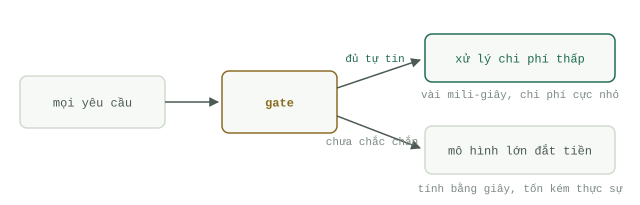

# Những quyết định chi phí thấp

Một `Agent` thực hiện hai loại công việc khác nhau. Nó viết — viết bản tóm tắt, kế hoạch, câu trả lời, mã nguồn — và nó ra quyết định — việc này có khẩn cấp không, tài liệu này thuộc về thư mục nào, trường hợp này có cần con người can thiệp không. Viết là tác vụ mở (open-ended) và thực sự cần đến một mô hình ngôn ngữ lớn. Ngược lại, ra quyết định là tác vụ đóng (bounded): câu trả lời chỉ nằm trong một tập hợp các lựa chọn mà bạn đã biết trước. Hầu hết các đường ống xử lý (pipelines) hiện nay đều đẩy cả hai loại công việc này cho cùng một mô hình tiên tiến đắt đỏ nhất (frontier model), chẳng khác nào thuê một luật sư cao cấp chỉ để ngồi phân loại phong bì thư.

Học phần này bàn về `Gate` (cổng phân luồng): một tầng ra quyết định chi phí thấp nằm ngay phía trước mô hình đắt tiền để phân loại luồng dữ liệu đầu vào, giúp mô hình lớn chỉ phải nhìn thấy những mục thực sự đòi hỏi khả năng phán đoán sâu.

Một lưu ý nhỏ về tên gọi: học phần này được đặt tên là `Gate`, gọi theo tên của mẫu kiến trúc (pattern). Còn cuốn cẩm nang chuyên sâu đi kèm có tên là [Kỹ thuật Jev (Jev engineering)](../track-jev/system-one-models.md), đặt theo tên dòng mô hình `System One` thường được dùng nhất để trấn giữ vị trí `Gate` này — tức là mối quan hệ giữa một mẫu kiến trúc và một công cụ mạnh mẽ để hiện thực hóa nó.

## Hai loại công việc

Hãy quan sát một `Agent` xử lý hộp thư đến và đếm số lượng các quyết định diễn ra. Đây có phải thư rác (spam) không? Đây có phải bản tin định kỳ (newsletter) không? Email này liên quan đến dự án nào? Có cần phải viết thư trả lời không? Chỉ sau khi trả lời xong tất cả những câu hỏi đó thì việc viết lách mới bắt đầu — và đối với phần lớn email, việc viết lách thậm chí không bao giờ xảy ra; bức thư chỉ đơn giản được phân vào thư mục, lưu trữ hoặc xóa bỏ. Việc dùng một mô hình tiên tiến nhất chỉ để trả lời câu hỏi "đây có phải là newsletter không" sẽ đốt mất hàng giây đồng hồ và tiền bạc thật chỉ để tạo ra đúng một bit thông tin. Quyết định phân loại đó đáng giá chưa tới một phần nhỏ của một xu. Trong khi đó, việc soạn thảo nội dung — trên số ít những mục thực sự cần đến nó — mới xứng đáng để trả mức giá đầy đủ.

## Gate là gì

Một `Gate` chỉ đặt ra đúng một câu hỏi hẹp cho mỗi mục dữ liệu và điều hướng luồng đi dựa trên câu trả lời nhận được. Hình thái hoạt động luôn cố định: mọi dữ liệu đi vào; mỗi mục nhận một câu hỏi đóng — chọn một trong các nhãn cho sẵn, trả lời có hoặc không, hoặc chấm một thang điểm; những mục mà `Gate` trả lời được một cách tự tin và quen thuộc sẽ được xử lý ngay bằng các đoạn code tất định (deterministic) siêu rẻ; bất cứ mục nào mà `Gate` không chắc chắn sẽ được chuyển tiếp vào trong cho mô hình chính. Không chắc chắn đồng nghĩa với việc chuyển giao lên tuyến trên (escalate). `Gate` không bao giờ là con đường duy nhất, nó chỉ là làn đường cao tốc mà thôi.

## Phân loại các công cụ làm Gate

Có bốn công cụ phổ biến, xếp theo thứ tự chi phí và độ phức tạp tăng dần:

- **Tập luật cứng (Rules).** Biểu thức chính quy (regex), danh sách người gửi được phép (allowlists), kiểm tra xem "có chứa liên kết hủy đăng ký (unsubscribe) hay không". Miễn phí, tức thời, nhưng hoàn toàn mù tịt trước bất kỳ tình huống nào bạn chưa kịp lường trước. Luôn luôn là lớp phòng tuyến đầu tiên, nhưng không bao giờ là lớp cuối cùng.
- **Bộ phân loại cổ điển (Classic classifier).** Hồi quy logistic (Logistic regression) hoặc các thuật toán tương tự chạy trên đặc trưng TF-IDF, được huấn luyện từ vài trăm mẫu dữ liệu đã gán nhãn của chính bạn. Chạy mất vài micro-giây ngay trên máy cá nhân, không tốn chi phí cho mỗi lần gọi, và khi nó đoán sai, bạn hoàn toàn có thể mổ xẻ nguyên nhân.
- **Mô hình LLM nhỏ.** Một mô hình cỡ Haiku được viết prompt để trả lời bằng đúng một từ duy nhất. Không cần dữ liệu huấn luyện trước và xử lý tốt các tình huống mới lạ, nhưng lại chậm nhất và đắt nhất trong nhóm các lựa chọn giá rẻ, đồng thời bạn phải viết code bóc tách văn bản (parse text) để lấy được câu trả lời.
- **Mô hình `System One`.** `Jev`, do TypeSafe AI phát hành vào tháng 9/2026, là đại diện đầu tiên của dòng này: đưa ra các quyết định có kiểu dữ liệu chặt chẽ (typed decisions) — có/không, chọn một trong tối đa 255 phương án, hoặc trả về một giá trị vô hướng trên thang đo có thứ tự — mỗi kết quả đều đi kèm điểm số độ tự tin (confidence score) và hoàn toàn không sinh văn bản. Kiến thức nền tảng về dòng mô hình này nằm ở bài [các mô hình System One](../track-jev/system-one-models.md).

## Nên đặt Gate ở đâu

Ở bất cứ nơi nào luồng dữ liệu đổ dồn vào. Ngay tại cổng tiếp nhận dữ liệu (ingestion), trước khi bất cứ thứ gì chạm tới `Agent` chính: thư rác, dữ liệu trùng lặp và các tài liệu tham khảo thuần túy không bao giờ được phép tiêu tốn dù chỉ một token của mô hình lớn. Đặt trước các lệnh gọi công cụ đắt đỏ: câu hỏi "truy vấn này có cần tìm kiếm trên web không" chính là một `Gate`. Và đặt bao quanh các hành động thực thi như những rào chắn bảo vệ (`Guardrails`): kiểm tra "hành động này có tính phá hủy dữ liệu không" dưới dạng câu hỏi có/không, và chặn đứng ngay nếu vượt ngưỡng rủi ro. Hãy xếp chồng chúng thành nhiều lớp — luật cứng đi trước, bộ phân loại đứng thứ hai, và chỉ gọi mô hình lớn cho những gì lọt qua được hai lớp đầu.

Việc sử dụng `Gate` là một quyết định về mặt kiến trúc, không phải quyết định chọn nhà cung cấp (vendor). Kiến trúc cốt lõi — câu hỏi hẹp, câu trả lời rẻ, chuyển giao lên tuyến trên khi nghi ngờ — luôn giữ nguyên bất kể bạn lắp công cụ nào vào vị trí đó. Còn việc nên chọn công cụ cụ thể nào là một câu hỏi thực nghiệm mà bạn phải trả lời bằng chính bộ dữ liệu đã gán nhãn của mình, và đó cũng là chủ đề của trang tiếp theo: [Ứng dụng Gate trong thực tế](gates-in-practice.md).
