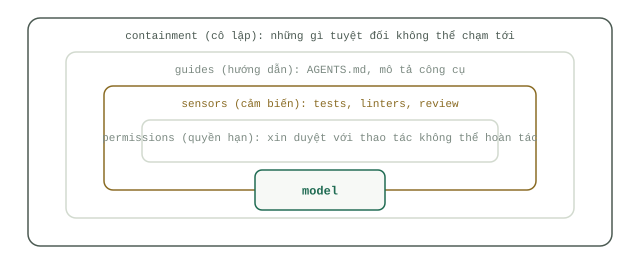

# Bốn vòng đai bảo vệ (The Four Rings)

Hãy xây dựng `Harness` theo hướng từ ngoài vào trong: vùng cô lập (containment), hướng dẫn (guides), cảm biến (sensors), và quyền hạn (permissions). Thứ tự này mang tính sống còn bởi mỗi vòng đai bên ngoài phải đủ sức giữ vững trận địa khi mọi vòng đai bên trong nó đều thất thủ. Một dòng hướng dẫn có thể bị phớt lờ, một cảm biến có thể bỏ sót lỗi, một hộp thoại xin phê duyệt có thể bị bấm nhầm; nhưng một bức tường vật lý thì không quan tâm. Vì vậy, vòng đai ngoài cùng phải được dựng lên trước khi dòng prompt đầu tiên được viết ra.




## Vòng đai thứ nhất: Vùng cô lập (Containment)

Vùng cô lập định nghĩa những thứ mà `Agent` hoàn toàn không thể chạm tới về mặt vật lý, và đây là vòng đai duy nhất hoạt động hiệu quả mà không cần bất kỳ sự hợp tác nào từ phía mô hình. Bộ trang bị tiêu chuẩn gồm có: một container hoặc máy ảo (VM) thay vì chạy trực tiếp trên shell máy tính cá nhân của bạn; một nhánh (branch) dùng một lần hoặc git worktree riêng thay vì nhánh `main`; một tài khoản cơ sở dữ liệu chỉ có quyền đọc (read-only) thay vì thông tin xác thực của ứng dụng chính; một danh sách mạng được phép truy cập (allowlist) thay vì mở toang ra toàn bộ internet. Không có bất kỳ biện pháp nào trong số này liên quan đến việc viết prompt. Nếu bạn thiết lập vòng đai này trước lần chạy đầu tiên của `Agent`, thì kịch bản tồi tệ nhất có thể xảy ra cũng chỉ là xóa bỏ một nhánh code nháp và tốn một hóa đơn API.

## Vòng đai thứ hai: Hướng dẫn (Guides)

Hướng dẫn là tất cả những gì `Agent` đọc trước khi hành động: các tập tin `AGENTS.md` (hoặc `CLAUDE.md`), mô tả công cụ (`Tool use`), và các ví dụ mẫu. Chúng rất rẻ và gánh vác phần lớn chất lượng công việc hàng ngày. Một tập tin `AGENTS.md` hữu ích chỉ dài bốn dòng, chứ không phải bốn trang giấy:

```markdown
- Monorepo: services live in services/, shared code in packages/. Run everything from the repo root.
- `make test` must pass before you call any task done.
- Never hand-edit files in migrations/ — generate them with `make migration`.
- Your database user is read-only. Ask before proposing any schema change.
```

Thiết kế công cụ là nửa còn lại của vòng đai này. Sách trắng của Google trên Kaggle có tên [Agent Tools & Interoperability with MCP](https://www.kaggle.com/whitepaper-agent-tools-and-interoperability-with-mcp) phân loại công cụ thành công cụ hàm (function tools), công cụ tích hợp sẵn (built-in tools) và công cụ `Agent` (agent tools), đồng thời các thực hành tốt nhất mà họ đưa ra đều xoay quanh nghệ thuật viết hướng dẫn: viết tài liệu mô tả cho từng công cụ đủ rõ ràng để mô hình có thể chọn đúng công cụ chỉ dựa vào phần mô tả, thiết kế công cụ xoay quanh các tác vụ hoàn chỉnh thay vì phơi bày nguyên bề mặt API thô, trả về kết quả đầu ra ngắn gọn, và biến các thông báo lỗi thành lời chỉ dẫn cách khắc phục. Hãy ưu tiên một công cụ có kiểu dữ liệu chặt chẽ thay vì cấp quyền truy cập thô — hàm `search_orders(customer_id)` vượt trội hơn hẳn việc giao cả kết nối SQL cho mô hình, bởi chính lược đồ tham số (schema) đã là một lớp cô lập. Lý lẽ mà sách trắng đưa ra để ủng hộ `MCP` nằm ở khả năng tương tác liên thông (interoperability): một giao thức mở duy nhất (JSON-RPC 2.0 qua stdio hoặc streamable HTTP) giúp N máy khách (clients) và M máy chủ công cụ (tool servers) chỉ cần viết một bản tích hợp cho mỗi bên, thay vì phải viết N×M bản tích hợp riêng lẻ. Phân tích toàn diện về chủ đề này nằm tại bài [công cụ và MCP](../track-harness/tools-and-mcp.md).

## Vòng đai thứ ba: Cảm biến (Sensors)

Cảm biến cho bạn biết một cách tất định (deterministic) liệu kết quả công việc có đảm bảo chất lượng hay không. Hãy cho chạy các cảm biến giá rẻ trên mọi thao tác: linter, bộ kiểm tra kiểu dữ liệu (type checker), và bộ kiểm thử (test suite) ngay sau mỗi thay đổi — chúng chỉ mất vài giây và không bao giờ biết mệt. Hãy để dành các cảm biến đắt đỏ — một mô hình thứ hai duyệt lại bản diff, hoặc một con người trực tiếp đọc kiểm tra — cho những phần thực sự trọng yếu: mã nguồn xác thực (auth code), kịch bản di chuyển dữ liệu (migrations), hoặc bất cứ thứ gì đụng chạm đến tiền bạc. Một `Harness` tự động chạy lệnh `make test` sẽ bắt được nhiều lỗi hơn hẳn một hệ thống chỉ trông chờ vào trí nhớ của người kiểm duyệt.

## Vòng đai thứ tư: Quyền hạn (Permissions)

Anthropic báo cáo rằng [người dùng Claude Code bấm chấp thuận tới 93% các hộp thoại xin cấp quyền](https://www.anthropic.com/engineering/claude-code-auto-mode). Một cánh cổng mở ra tới 93 lần trong số 100 lần gõ cửa sẽ huấn luyện con người ngừng đọc nội dung bên trong nó. Sự bảo vệ thực sự nằm ở vòng đai thứ nhất — tức là những hành động hoàn toàn không có sẵn để gọi — vì vậy hãy chỉ dùng hộp thoại xin phê duyệt cho những thao tác thực sự không thể đảo ngược: đẩy code lên nhánh dùng chung, gửi thông tin ra bên ngoài, hoặc xóa bất kỳ dữ liệu nào. Mỗi ngày chỉ hiện ba hộp thoại thì người ta còn đọc; hiện tới ba mươi hộp thoại thì người ta chỉ bấm cho qua.

## Hook: Những lời hướng dẫn có răng sắc

Một dòng hướng dẫn mà mô hình có thể đọc lướt qua sẽ biến thành một quy tắc cứng được `Harness` cưỡng chế thực thi. Trong Claude Code, một `Hook` loại `PreToolUse` sẽ chạy trước mỗi lệnh gọi công cụ và có quyền chặn đứng lệnh đó; đoạn cấu hình dưới đây cưỡng chế quy tắc "tuyệt đối không đẩy code thẳng lên nhánh main":

```json
{
  "hooks": {
    "PreToolUse": [
      {
        "matcher": "Bash",
        "hooks": [
          {
            "type": "command",
            "command": "jq -r '.tool_input.command' | grep -qE 'git push.*\\bmain\\b' && { echo 'Blocked: never push to main' >&2; exit 2; } || exit 0"
          }
        ]
      }
    ]
  }
}
```

Mã thoát (exit code) bằng 2 sẽ chặn lệnh gọi công cụ và gửi trả thông báo lỗi về lại cho `Agent`, giúp nó tự điều chỉnh hướng đi thay vì thất bại trong im lặng.

## Những khoản cược rồi sẽ hết hạn

Mỗi thành phần trong các vòng đai bảo vệ thực chất là một khoản đặt cược rằng mô hình hiện tại chưa thể tự làm tốt việc gì đó. Anthropic từng phải bổ sung cơ chế xóa làm mới `Context` (context resets) vào `Harness` bởi mô hình Claude Sonnet 4.5 thường tự ý kết thúc sớm công việc khi tiến gần đến giới hạn `Context window` — nhưng sau đó họ đã [xóa bỏ hoàn toàn thành phần này](https://www.anthropic.com/engineering/harness-design-long-running-apps) khi thế hệ Opus 4.5 không còn mắc tật đó nữa. Các khoản cược của bạn rồi cũng sẽ hết hạn theo đúng cách như vậy. Bài [Thực hành xây dựng Harness](harness-practice.md) sẽ biến việc rà soát này thành một nghi thức định kỳ hàng quý.
