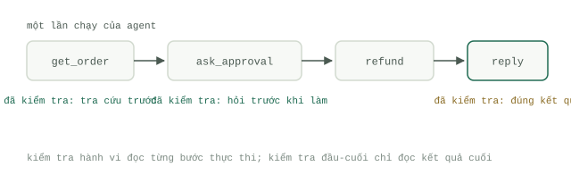

# Hai loại kiểm tra

Các học phần trước đã giúp bạn xây dựng một `Agent` biết lập kế hoạch, gọi công cụ (`Tool use`), và chỉnh sửa kho tài liệu của bạn. Học phần này giải quyết câu hỏi làm sao để biết chắc chắn nó đang hoạt động đúng — trước khi người dùng của bạn lên tiếng phàn nàn. Toàn bộ lĩnh vực đánh giá `Agent` (`Evals`) xoay quanh một sự phân biệt cốt lõi: kiểm tra kết quả đầu ra cuối cùng (outcome checks) so với kiểm tra hành vi trong quá trình chạy (behavioural checks). Bạn cần cả hai loại này, và mỗi loại trả lời một câu hỏi hoàn toàn khác nhau.

## Kiểm tra toàn trình (End-to-end checks)

Một bài kiểm tra toàn trình chỉ đặt ra một câu hỏi duy nhất: câu trả lời cuối cùng đưa ra có đúng hay không? Cho chạy dữ liệu đầu vào, lấy tin nhắn cuối cùng hoặc trạng thái hệ thống sau khi chạy xong, rồi chấm điểm nó — bằng cách so khớp chính xác (exact match), dùng bảng tiêu chí (rubric), hoặc dùng một giám khảo AI (`LLM-as-judge`). Đây là bài kiểm tra mà chính người dùng sẽ thiết kế, bởi nó đo lường trực tiếp kết quả mà họ trải nghiệm.

Điểm mạnh của nó cũng chính là giới hạn của nó. Khi tỷ lệ vượt qua (pass rate) tụt từ 84% xuống 71% sau một lần chỉnh sửa prompt, bộ kiểm tra toàn trình chỉ báo cho bạn biết rằng điểm số đã thay đổi. Nó hoàn toàn không cho bạn biết tại sao. Bạn vẫn phải ngồi đọc thủ công từng bản ghi hội thoại (transcript) bị lỗi một, bởi nguyên nhân thất bại có thể nằm ở khâu truy xuất dữ liệu, ở việc truyền sai tham số công cụ, ở một bước xác minh bị bỏ qua, hay chỉ đơn giản là cách diễn đạt ở câu trả lời cuối cùng. Sách trắng [Agent Quality whitepaper](https://www.kaggle.com/whitepaper-agent-quality) của Google coi đây là phương pháp đánh giá hộp đen (black-box evaluation) — "`Agent` có đạt được mục tiêu của người dùng hay không?" — và luôn kết hợp nó với góc nhìn hộp kính trong suốt (glass-box view) soi chiếu toàn bộ con đường mà `Agent` đã đi qua, dựa trên nguyên lý được họ đúc kết ngắn gọn là "lộ trình thực thi chính là sự thật" (the trajectory is the truth).

## Kiểm tra hành vi (Behavioural checks)

Một bài kiểm tra hành vi hỏi xem liệu một hành động cụ thể nào đó có thực sự diễn ra trên con đường đi tới câu trả lời hay không. `Agent` có gọi công cụ tìm kiếm trước khi trả lời không? Nó có đặt câu hỏi làm rõ khi yêu cầu của người dùng mơ hồ không? Nó có kiểm tra xem tập tin đã thực sự tồn tại trên ổ đĩa chưa trước khi tuyên bố đã hoàn thành tác vụ không? Mỗi bài kiểm tra hành vi đều rất hẹp, mang tính nhị phân (đúng/sai), và cực rẻ — nó là một phép khẳng định trong code (assertion), chứ không phải một sự phán xét cảm tính.

Giá trị mang lại chính là khả năng chẩn đoán lỗi tức thì. Hai `Agent` cùng tạo ra một bức thư hoàn tiền giống hệt nhau không phải là hai `Agent` có chất lượng ngang nhau nếu một bên tra cứu thông tin đơn hàng trước khi viết, còn bên kia chỉ đoán mò. Một bài kiểm tra toàn trình sẽ chấm điểm hai bên bằng nhau; nhưng bài kiểm tra hành vi sẽ phân tách chúng ra ngay ngày hôm nay, trước khi kẻ đoán mò gặp phải một đơn hàng mà nó đoán trật.

## Vết thực thi (Traces) là nền móng

Các bài kiểm tra hành vi chạy trực tiếp trên vết thực thi (`Traces`): bản ghi đầy đủ toàn bộ các lượt gọi mô hình, các lệnh gọi công cụ kèm theo tham số đầu vào, kết quả trả về từ công cụ, và các lần thử lại (retries). Không có `Traces` thì không thể có kiểm tra hành vi — đó là lý do sách trắng của Google lập luận rằng các `Agent` phải được gắn thiết bị đo đạc phục vụ đánh giá ngay từ dòng code đầu tiên, với nhật ký (logs), vết thực thi (`Traces`) và chỉ số đo lường (metrics) làm ba trụ cột của khả năng quan sát hệ thống (observability). Nếu `Agent` của bạn là một thiết lập trên Claude Code, thì bản thân tập tin transcript đã chính là một `Trace` hoàn chỉnh; hãy lưu log nó lại. Những gì cần kiểm tra khẳng định (assert) trên đó — lựa chọn công cụ, trích xuất tham số, ràng buộc thứ tự gọi, xử lý lỗi — được phân tích chuyên sâu tại bài [đánh giá Agent (agent evals)](../track-evals/agent-evals.md).

## Ngân sách tốc độ thực thi

Hãy chia bộ `Evals` của bạn thành hai tầng. Tầng chạy nhanh (fast tier) chỉ bao gồm các phép kiểm tra hành vi tất định: không gọi mô hình, không gọi mạng, chỉ có code thuần đọc và kiểm tra trên `Traces`. Hãy giữ cho tầng này chạy nhanh đến mức không ai phải đắn đo xem có nên bấm chạy nó hay không — vài giây đồng hồ, cứ cho là năm giây, là một ngân sách thời gian hợp lý. Vượt quá ngưỡng đó, nó sẽ biến thành thứ mà người ta chỉ chạy trước khi gộp nhánh code (merge) thay vì chạy sau mỗi lần chỉnh sửa, và vòng lặp phản hồi nhanh sẽ chết yểu. Tầng chạy chậm (slow tier) — chạy toàn trình từ đầu đến cuối kèm theo giám khảo chấm điểm (`LLM-as-judge`) — sẽ được lên lịch chạy hàng đêm và chạy trước mỗi đợt phát hành phiên bản mới. Cấu trúc gọn trong một tập tin tại bài [xây dựng bộ kiểm thử (build the suite)](../track-evals/build-suite.md) hỗ trợ sẵn cách phân tách hai tầng này một cách rất tự nhiên.

## Khi nào mỗi loại kiểm tra phát huy giá trị

Kiểm tra toàn trình phát huy giá trị tại các thời điểm ra quyết định lớn: xuất bản một bản phát hành mới, thay đổi mô hình nền tảng, hoặc so sánh hiệu quả giữa hai phiên bản prompt. Trong khi đó, kiểm tra hành vi phát huy tác dụng suốt quá trình phát triển hàng ngày, nơi bạn vừa sửa một chi tiết nhỏ và muốn biết ngay trong vòng vài giây xem thay đổi đó đã làm xáo trộn những hành vi nào.

Có một cái bẫy cần tránh ngay từ ngày đầu tiên: hãy theo dõi kết quả của từng bài kiểm tra riêng lẻ, đừng chỉ nhìn vào tỷ lệ vượt qua tổng thể (overall pass rate). Con số trung bình tổng thể hoàn toàn có thể tăng lên trong khi một hành vi cốt lõi âm thầm bị hỏng — chẳng hạn năm ca kiểm thử chập chờn bỗng nhiên vượt qua, cùng lúc đó `Agent` ngừng hẳn việc xin phê duyệt trước khi thực hiện hoàn tiền. Con số tổng hợp báo cáo rằng hệ thống đang tiến bộ; nhưng lịch sử chi tiết từng bài kiểm tra lại báo động một sự cố nghiêm trọng. Bản thân việc chấm điểm ở tầng chạy chậm cũng là một bài toán riêng đầy thách thức, và đó là lúc chúng ta cần đến [giám khảo AI và bộ dữ liệu chuẩn (Golden sets)](judges-and-golden-sets.md).
