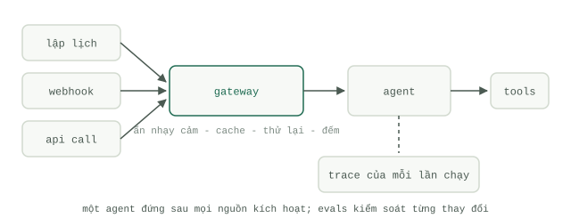

# Từ bản thử nghiệm đến Production

Mọi học phần từ đầu đến giờ đều kết thúc bằng một thứ chạy tốt trên máy tính cá nhân của bạn. Học phần này bàn về những gì xảy ra khi những người khác — hoặc một trình lập lịch tự động lúc 3 giờ sáng — bắt đầu phụ thuộc vào nó. Sách trắng *Prototype to Production* của Google (Kaggle, tháng 11/2025) mở đầu bằng một nhận định rất thẳng thắn: "Xây dựng một `Agent` thì dễ. Tin tưởng giao việc cho nó mới khó." Họ ước tính rằng khoảng 80% công sức khi đưa một `Agent` vào thực tế nằm ở phần hạ tầng, bảo mật và xác thực — chứ không phải ở việc làm cho `Agent` thông minh hơn.

## Những gì sẽ vỡ vụn khi bản demo chạm trán lưu lượng thực tế

Một bản demo chỉ chạy khi có mặt bạn đang ngồi quan sát, trên những dữ liệu đầu vào do chính bạn chọn lọc, và dùng thông tin xác thực cá nhân của bạn. Môi trường `Production` tước bỏ cả ba sự ưu ái đó cùng một lúc. Danh sách các sự cố sẽ xảy ra hoàn toàn có thể đoán trước:

- **Độ tin cậy (Reliability).** Các nhà cung cấp mô hình có lúc bị quá thời gian chờ (time out), giới hạn tần suất gọi (rate-limit), và thỉnh thoảng trả về dữ liệu rác. Nếu không có cơ chế thử lại kèm độ trễ tăng dần (retries with backoff) và các công cụ đảm bảo tính lũy đẳng (idempotent tools — gọi nhiều lần vẫn cho kết quả như gọi một lần), chỉ một lệnh gọi mạng chập chờn cũng sẽ phá hỏng toàn bộ phiên chạy — và một công cụ không lũy đẳng khi bị gọi thử lại sẽ gửi cùng một bức thư điện tử đi tới hai lần.
- **Chi phí (Cost).** Một `Loop` chỉ tốn 40 xu khi bạn ngồi canh chừng sẽ tiêu tốn bất kỳ con số nào nó muốn khi bạn rời mắt khỏi màn hình. Các phiên chạy không có rào chắn bắt buộc phải được gắn [trần giới hạn số lượt và tiền mặt](../course-2-loop/loops-vs-workflows.md) trước bất kỳ bước triển khai nào khác.
- **Dữ liệu đầu vào (Inputs).** Lưu lượng thực tế chứa đầy những tập tin sai định dạng, văn bản có ác ý tấn công, và những trường hợp biên (edge cases) mà ba câu prompt kiểm thử của bạn chưa bao giờ chạm tới.
- **Sự thay đổi (Change).** Trong bản demo, câu prompt nằm ở bất cứ chỗ nào bạn vừa dán vào lần cuối. Trên môi trường `Production`, một thao tác sửa prompt không được theo dõi phiên bản chẳng khác nào một đợt triển khai phần mềm mù không ai có thể kiểm duyệt.

Sách trắng định hình bước chuyển dịch này thành một kỷ luật kỹ thuật được gọi là AgentOps: việc kiểm tra ngẫu nhiên bằng mắt được thay thế bằng các cổng kiểm duyệt tự động (`Gate`), những tinh chỉnh tùy hứng trở thành các phiên bản prompt và công cụ được quản lý chặt chẽ, và câu nói cảm tính "trông có vẻ ổn rồi đấy" được thay bằng nhật ký (logs), vết thực thi (`Traces`) và các chỉ số đo lường (metrics).

## Ba hình thái triển khai, cùng một Agent

Các `Agent` trên môi trường `Production` được kích hoạt theo ba cách: chạy theo **lịch định kỳ** (schedule — ví dụ bản tổng hợp tin tức mỗi đêm), chạy theo **sự kiện** (event — khi có tập tin mới tải lên hoặc có webhook bắn về), hoặc đặt phía sau một **API** (khi một người dùng hoặc một hệ thống khác gửi yêu cầu trực tiếp ngay lập tức). Kiến trúc AIP của Palantir mô tả chính xác bộ ba này — tự động hóa theo lịch trình, tự động hóa hướng sự kiện theo thời gian thực, và các tác vụ gọi qua API — tất cả đều chạy chung trên cùng một tầng dữ liệu và hành động nền tảng bên dưới.

Hệ quả thiết kế rút ra: hãy tách biệt hoàn toàn logic cốt lõi của `Agent` ra khỏi bộ kích hoạt (trigger) của nó. Một bản định nghĩa `Agent` duy nhất, đi kèm ba bộ chuyển đổi (adapters) mỏng. Nếu phiên bản chạy theo lịch và phiên bản chạy qua API của bạn nằm ở hai kho mã nguồn (codebases) tách rời, thì mọi bản vá lỗi từ nay sẽ phải cập nhật ở cả hai nơi, và sớm muộn gì một trong hai bên cũng sẽ bị lệch pha.

## Một cổng kết nối (Gateway) duy nhất đứng trước mọi lệnh gọi mô hình

Mảnh ghép hạ tầng mang lại đòn bẩy lớn nhất chính là một cổng kết nối trung tâm (gateway) — một điểm chốt chặn duy nhất mà mọi lệnh gọi mô hình bắt buộc phải đi qua, không có ngoại lệ. Nó đảm nhiệm bốn công việc:

- **Che giấu dữ liệu nhạy cảm (Masking).** Loại bỏ hoặc ẩn danh hóa các trường thông tin nhạy cảm trước khi gói dữ liệu rời khỏi ranh giới hệ thống của bạn.
- **Lưu bộ nhớ đệm (Caching).** Trả về kết quả đã lưu trong cache đối với các phần tiền tố lặp lại và các lệnh gọi giống hệt nhau.
- **Thử lại và chuyển đổi dự phòng (Retries and failover).** Quản lý cơ chế chờ thử lại (backoff), tự động chuyển sang nhà cung cấp dự phòng khi bên chính gặp sự cố, và tích hợp công tắc ngắt khẩn cấp (kill switch) tại một nơi duy nhất.
- **Hạch toán token (Token accounting).** Gắn thẻ cho từng lệnh gọi để biết rõ ai hoặc tác vụ nào đã kích hoạt nó và chi phí hết bao nhiêu.

Đây là mô hình chuẩn mà mọi hệ thống trưởng thành đều hội tụ về: Palantir điều hướng toàn bộ lưu lượng truy cập LLM đi qua một tầng tích hợp bảo mật duy nhất có theo dõi mức tiêu thụ token và ghi nhật ký kiểm toán đồng nhất, thay vì để từng ứng dụng tự gọi thẳng tới các nhà cung cấp mô hình. Bạn không cần phải mua nền tảng của Palantir mới học theo được cấu trúc này — một dịch vụ proxy dài khoảng 200 dòng code đã mang lại cho bạn phần lớn lợi ích kể trên.

## Lộ trình triển khai mà sách trắng vạch ra

Lộ trình đưa lên `Production` trong sách trắng là một vòng đời khép kín, chứ không phải một sự kiện bấm nút ra mắt đơn lẻ: từ môi trường phát triển (development — thử nghiệm nhanh), sang môi trường tiền triển khai (staging — kiểm thử tự động và giả lập tải), rồi mới tới môi trường thực tế (`Production` — triển khai cuốn chiếu từng phần kèm giám sát chặt chẽ). Các bản phát hành được tung ra theo phương thức canary (thử nghiệm trên một tỷ lệ nhỏ người dùng) hoặc blue-green (duy trì song song hai môi trường) với khả năng quay lui (rollback) tức thì, tuyệt đối không bao giờ chuyển đổi đột ngột 100% lưu lượng cùng lúc. Bộ kiểm thử đánh giá (`Evals`) chạy tự động trong quy trình CI và chặn đứng đợt triển khai ngay khi điểm số sụt giảm — [hai loại kiểm tra](../course-5-evals/two-kinds-of-checks.md) từ học phần 5 giờ đây trở thành cổng chặn thực thi, chứ không chỉ là một bảng biểu để ngắm. Và vòng lặp cứ thế khép kín: `Traces` thu được từ môi trường `Production` lại được nạp ngược về làm giàu cho bộ dữ liệu `Evals`, giúp bản phát hành tiếp theo ngày càng cứng cáp hơn.

Không có điều gì trong số này là kỳ bí hay xa lạ. Đó đơn thuần là kỷ luật kỹ thuật phần mềm truyền thống được áp dụng lên một thành phần có bản chất xác suất. Trang tiếp theo sẽ đi sâu vào khía cạnh vận hành hàng ngày: [quan sát, kiểm soát chi phí và bảo mật hệ thống một khi nó đã chạy](operating-agents.md).
